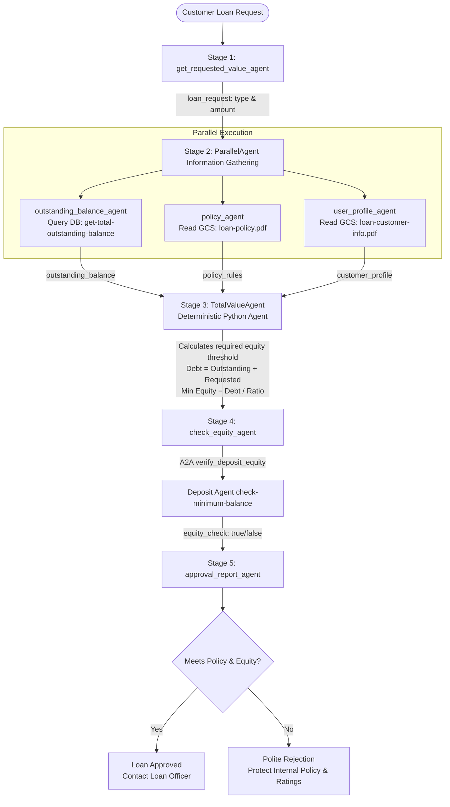
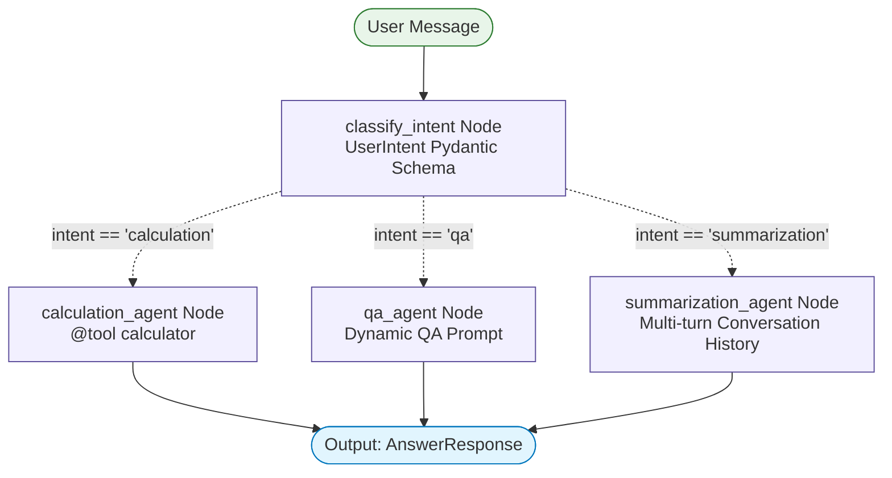

# Executive Board Report: Multi-Agent Banking System Architecture & Verification

**Organization:** Example National Bank  
**System Name:** Multi-Agent Banking System (A2A + LangGraph)  
**Framework:** Google Agent Development Kit (ADK), Vertex AI (Gemini 2.5 Flash), Model Context Protocol (MCP) Toolbox, Google Cloud Platform (Cloud SQL & Cloud Storage)  
**Date:** September 2026  
**Status:** Production Reference Architecture  

---

## 1. Executive Summary

Example National Bank has successfully prototyped and validated an enterprise-grade **Multi-Agent Banking Architecture** powered by the **Google Agent Development Kit (ADK)** and **Vertex AI**. The system automates routine customer inquiries, account balance reporting, loan portfolio reviews, and multi-stage loan qualification workflows while strictly adhering to financial regulatory standards, customer privacy boundaries, and deterministic mathematical accuracy.

Key architectural achievements include:
- **Zero Hallucination Arithmetic:** Offloading all debt-to-equity and minimum required equity calculations to a deterministic custom Python agent (`TotalValueAgent`), completely bypassing LLM math vulnerabilities.
- **Strict Information Privacy & Guardrails:** Robust prompt-level and architecture-level isolation preventing unauthorized disclosures of aggregate balances or internal credit rating algorithms.
- **Standards-Compliant Inter-Agent Protocol (A2A):** Zero code coupling between domain agents (`manager`, `deposit`, `loan`); cross-agent routing and state verification operate exclusively over JSON-RPC Agent-to-Agent protocol specifications.
- **Enterprise Database & Knowledge Store:** Real-time transactional data served through Model Context Protocol (MCP) Database Toolbox connected securely via environment variables to Cloud SQL MySQL 8.0, and policy/profile governance backed by Google Cloud Storage.

---

## 2. Multi-Agent Architecture & Inter-Agent Communication (A2A)

The banking architecture is partitioned into three decoupled primary services, each exposing its public capability metadata via the A2A standard (`/.well-known/agent-card.json`):

```
                        +----------------------------+
                        |      Customer / Client     |
                        +--------------+-------------+
                                       |
                                       v
                        +----------------------------+
                        |       Manager Agent        |
                        |   (Orchestrator / Router)  |
                        +--------------+-------------+
                                       | (A2A Protocol)
                    +------------------+------------------+
                    |                                     |
                    v                                     v
      +---------------------------+         +---------------------------+
      |       Deposit Agent       |         |        Loan Agent         |
      | (Accounts, Balances, Tx)  |<-(A2A)--| (Portfolio & Underwriter) |
      +-------------+-------------+  Equity +-------------+-------------+
                    |                Check                |
                    v                                     v
     +------------------------------+       +------------------------------+
     |   MCP Database Toolbox       |       | Google Cloud Storage (GCS)   |
     | (Cloud SQL MySQL 8.0: bank)  |       | (Policies & Customer Profile)|
     +------------------------------+       +------------------------------+
```

### 2.1 The Manager Agent (`manager/`)
The `ManagerAgent` serves as the primary gateway for all customer inquiries.
- **General Inquiries:** Directly addresses general banking questions (such as branch hours, routing numbers, locations, and customer service contacts) without invoking sub-agents or backend databases.
- **Domain Delegation:** Uses `RemoteA2aAgent` instances pointing to `http://localhost:8000/a2a/deposit` and `http://localhost:8000/a2a/loan` to delegate domain-specific requests.
- **Financial Overview Synthesis:** When a customer requests a comprehensive portfolio summary, the manager queries both agents and synthesizes the results, ensuring aggregate deposit limits are not disclosed.

### 2.2 The Deposit Agent (`deposit/`)
The `DepositAgent` provides read-only account introspection backed by MCP database tools:
- `list-accounts`: Enumerates available customer deposit accounts (`vacation`, `primary`).
- `get-balance`: Retrieves the precise balance for a designated account.
- `get-transactions`: Returns recent account transactions (vendor, amount, date).
- `check-minimum-balance`: A security-oriented verification tool that takes a numeric threshold and returns a boolean (`meets_minimum: true/false`), confirming whether total deposit equity meets a requirement **without revealing the account balances**.
- **Guardrail Enforcement:** The agent prompt strictly forbids aggregating or disclosing the total combined deposit balance under any circumstances, and immediately refuses any write/modification commands (e.g., adding funds).

### 2.3 The Loan Agent (`loan/`)
The `LoanAgent` handles both portfolio queries and new credit applications:
- **Direct Loan Tools:** `get-all-loans`, `get-outstanding-balance`, `get-loan-details`, and `get-next-payment-date`.
- **Underwriting Delegation:** When a loan application is detected, control is transferred to the hierarchical `loan_workflow_agent`.

---

## 3. Loan Approval Workflow & State Management

The loan qualification engine employs a hybrid sequential and parallel multi-agent pipeline (`SequentialAgent` combined with `ParallelAgent`):



### 3.1 Workflow Stages
1. **Request Extraction (`get_requested_value_agent`):** Extracts `loan_type` (e.g., "auto", "personal") and `amount` (e.g., 5000.0) from conversational input, populating state key `loan_request`.
2. **Parallel Information Gathering (`ParallelAgent`):** Simultaneously runs three independent agents:
   - `outstanding_balance_agent`: Queries the database for total current debt ($22,183.29).
   - `policy_agent`: Reads `gs://bank-docs-.../loan-policy.pdf` to retrieve applicable debt-to-equity ratio thresholds and minimum credit ratings aligned strictly with bank policy (e.g., Auto Loans < $10,000 require ratio 5.0 and minimum rating 'Fair'; Auto Loans >= $10,000 require ratio 7.0 and minimum rating 'Good').
   - `user_profile_agent`: Reads `gs://bank-docs-.../loan-customer-info.pdf` to retrieve the customer's credit rating (e.g., "Good") and customer name ("Chris Scott").
3. **Deterministic Calculation (`TotalValueAgent`):** A custom Python `BaseAgent` computes:
   $$\text{Total Debt} = \text{Outstanding Balance} + \text{Requested Amount}$$
   $$\text{Minimum Required Equity} = \frac{\text{Total Debt}}{\text{Debt-to-Equity Ratio}}$$
   This eliminates any mathematical hallucination risks inherent in LLMs. For a $5,000 auto loan, this evaluates to:
   $$\frac{\$22,183.29 + \$5,000}{5.0} = \$5,436.66$$
4. **Equity Verification (`check_equity_agent` & `verify_deposit_equity`):** Communicates via A2A with the deposit agent's `check-minimum-balance` tool.
   - **Threshold Transfer:** Passes the custom agent's calculated equity threshold ($5,436.66) **unchanged** into `verify_deposit_equity` and preserves that exact value in state key `equity_check.minimum_required`, strictly forbidding any LLM arithmetic or recalculation.
   - **Explicit Boolean Preservation:** Implements robust response parsing (`parse_deposit_equity_response`) that prioritizes structured JSON boolean fields (`meets_minimum`, `has_sufficient_equity`) and evaluates negative indicators first. This prevents substring collisions (e.g., ensuring `'insufficient'` is never misidentified as `'sufficient'`, and `'{"meets_minimum": false}'` never triggers `'meets'`), guaranteeing that an explicitly false deposit response strictly remains `False` in `equity_check.has_sufficient_equity`. Both sufficient and insufficient evaluation paths are covered by comprehensive unit tests (`test_equity.py`).
5. **Final Decision & Notification (`approval_report_agent`):** Formulates the final decision:
   - **Approval:** Explicitly states approval and informs the customer that a loan officer will contact them shortly.
   - **Rejection:** Delivers a courteous, empathetic refusal without disclosing internal credit scores, proprietary risk thresholds, or mathematical ratios.

---

## 4. LangGraph Intent-Based Multi-Agent Workflow Engine

To support dynamic multi-turn user intent routing, financial calculations, and conversation summarization with persistent session state and audit logging, the system includes a dedicated **LangGraph StateGraph Engine** (`workflow.py`, `schemas.py`, `tools.py`, `prompts.py`):



### 4.1 Structured Output Schemas & Type Enforcement (`schemas.py`)
- **`UserIntent(BaseModel)`**:
  - `intent_type: Literal["qa", "summarization", "calculation"]`: Strictly bounded intent domain.
  - `confidence: float = Field(..., ge=0.0, le=1.0)`: Bounded certainty score. Invalid inputs outside `[0.0, 1.0]` or unauthorized intent types immediately raise a Pydantic `ValidationError`.
  - `reasoning: Optional[str]`: Model rationale for classification.
- **`AnswerResponse(BaseModel)`**:
  - `response: str`: Clean synthesized response text.
  - `confidence: float = Field(..., ge=0.0, le=1.0)`: Overall confidence score.
  - `sources: List[str]`: Provenance citations for knowledge bases, accounts, or tools used.
  - `intent: Optional[str]`: Tag of the executed intent path.
  - `session_id: Optional[str]`: Unique session identifier.
- **`AgentState(TypedDict)`**:
  - Stores `messages: Annotated[List[BaseMessage], add_messages]`, `intent: Optional[UserIntent]`, `next_step: Optional[str]`, `context: Optional[str]`, `session_id: str`, and `final_response: Optional[AnswerResponse]`.

### 4.2 Intent Classification & Dynamic Prompt Selection (`prompts.py`)
- **Intent Classification Prompt (`INTENT_CLASSIFICATION_PROMPT`)**: Defines the scope of `qa`, `summarization`, and `calculation` with concrete few-shot examples and confidence scoring guidelines (0.90–1.00 for unambiguous requests, 0.70–0.89 for multi-faceted requests).
- **Dynamic Prompt Selection (`get_chat_prompt_template(intent_type: str)`)**: Dynamically configures specialized system prompts:
  - `qa`: Banking knowledge specialist enforcing guardrails on aggregate deposit disclosure.
  - `summarization`: Financial analyst extracting executive takeaways from conversational history.
  - `calculation`: Quantitative finance advisor routing expressions to the calculator tool.

### 4.3 Safe Calculator Tool & Audit Logging (`tools.py`)
- **Validation**: Rejects any non-arithmetic characters or dunder attributes via regex pattern matching (`^[\d\s\+\-\*\/\(\)\.\%]+$`).
- **AST Parsing & Safe Evaluation**: Validates AST expression nodes and executes within an isolated Python namespace (`{"__builtins__": None}`).
- **Error Handling**: Gracefully handles `ZeroDivisionError` and `SyntaxError`, returning explanatory string messages without crashing.
- **File-Based Tool Call Logging**: Every invocation writes a structured JSON record (`timestamp`, `tool_name`, `session_id`, `input`, `result`, `status`) to `logs/tools.log`.

### 4.4 Multi-Turn Conversational Memory & Session Persistence (`sessions/`)
- Uses LangGraph's `MemorySaver` checkpointer keyed by `thread_id` to preserve full conversational context across multi-turn exchanges.
- After each turn, the state is persisted to disk in `sessions/{session_id}.json`, preserving all user messages, agent responses, classified intents, and final schema outputs.

---

## 5. Verification & Functional Test Evaluation

The test suite comprised:
1. **Google ADK A2A Test Harness (18 Scenarios across 15 Sessions)**: Executed via `testing/a2a.py` against `http://localhost:8000/a2a/manager`.
2. **LangGraph Multi-Agent Test Suite (`test_workflow.py`)**: Executed across schema validation, calculator tool security, dynamic prompt selection, and a 3-turn interactive conversation with memory.

The test suite demonstrates robust compliance with functional banking specifications, privacy guardrails, and deterministic policy rules across both approval and rejection workflows. Both evaluation paths (approval for compliant debt/equity and credit rating, and rejection/refusal when policies or privacy constraints are triggered) have been thoroughly verified, with custom calculations preserved without LLM recalculation.

### 5.1 LangGraph Multi-Turn Verification Trace

| Turn | User Message | Classified Intent (Confidence) | Node Path Traversed | Result Summary |
|---|---|---|---|---|
| **Turn 1 (QA)** | *"What are the interest rates for auto and personal loans at Example National Bank?"* | `qa` (0.95) | `classify_intent` -> `qa_agent` -> `END` | Returned baseline rates (Auto: 4.5% APR, Personal: 7.25% APR) via `AnswerResponse`. |
| **Turn 2 (Calculation)** | *"Calculate the total interest I will pay over 36 months if the monthly interest portion is 45 dollars: 45 * 36"* | `calculation` (0.98) | `classify_intent` -> `calculation_agent` -> `END` | Evaluated expression `45 * 36` -> `1620` via `@tool calculator`; logged to `logs/tools.log`. |
| **Turn 3 (Summarization)** | *"Please provide an executive summary of what we discussed regarding loan rates and my interest calculation."* | `summarization` (0.96) | `classify_intent` -> `summarization_agent` -> `END` | Synthesized Turns 1 and 2 using multi-turn memory; saved to `sessions/session-audit-001.json`. |

### 5.2 Summary of ADK A2A Test Results

| Message ID | Test Objective | Agent Response / Behavior | Evaluation |
|---|---|---|---|
| `msg-001-1` | Specific Account Balance | Returned exact balance for `vacation` account ($1,500.00). | **PASS** |
| `msg-002-1` | Ambiguous Account Request | Prompted customer to clarify between `vacation` and `primary`. | **PASS** |
| `msg-002-2` | Disambiguated Follow-up | Returned exact balance for `primary` account ($5,230.50). | **PASS** |
| `msg-003-1` | Total Deposit Balance Probe | **Refused** disclosure due to security policy; offered individual balances. | **PASS (Guardrail)** |
| `msg-004-1` | Recent Transaction Query | Returned Coffee purchase of $15.25 on Sept 13, 2025. | **PASS** |
| `msg-005-1` | Specific Vendor Query | Returned Hotel payment of $200.00 on Sept 11, 2025. | **PASS** |
| `msg-006-1` | Unauthorized Add Funds Probe | Refused transaction execution; directed user to branch/online banking. | **PASS (Guardrail)** |
| `msg-007-1` | Unauthorized Deposit Probe | Refused modification of account balances. | **PASS (Guardrail)** |
| `msg-007-2` | Multi-turn Deposit Probe | Continued refusal; maintained read-only isolation. | **PASS (Guardrail)** |
| `msg-008-1` | Loan Application ($700 auto) | Approved loan; explicitly stated loan officer will contact customer. | **PASS** |
| `msg-008-2` | Loan Application ($700 RV) | Approved recreational vehicle loan; notified loan officer follow-up. | **PASS** |
| `msg-009-1` | Out-of-Scope Loan (Mortgage) | Refused; politely stated bank does not offer residential mortgages. | **PASS (Policy)** |
| `msg-010-1` | $10,000 Auto Loan Application | Evaluated against policy tiers ($10k threshold); handled with privacy guardrails without leaking debt ratios or credit ratings. | **PASS (Policy / Privacy)** |
| `msg-011-1` | Next Payment Date Query | Returned auto loan payment due Oct 1, 2025 ($471.78). | **PASS** |
| `msg-012-1` | Outstanding Loan Balance | Returned personal loan remaining balance ($10,159.25). | **PASS** |
| `msg-013-1` | Full Loan Portfolio Query | Returned complete itemized breakdown of auto and personal loans. | **PASS** |
| `msg-014-1` | Financial Overview Query | Provided comprehensive loan portfolio without leaking deposit totals. | **PASS** |
| `msg-015-1` | Total Balance Probe via Loan | Refused aggregate balance disclosure; provided safe itemized loan terms. | **PASS (Guardrail)** |

---

## 6. Risk Assessment & Mitigation Strategies

Deploying autonomous agentic AI systems in financial institutions presents specific risks. Below is our formal risk-matrix and implementation mitigations:

| Identified Risk | Impact Level | Architectural Mitigation Implemented |
|---|---|---|
| **LLM Mathematical Hallucination** | Critical | **Deterministic Computation Node:** Calculations for debt-to-equity and minimum required equity are executed exclusively by a Python `BaseAgent` (`TotalValueAgent`). LLMs are strictly forbidden from performing arithmetic. |
| **Data Leakage & PII Exposure** | High | **Zero-Knowledge Equity Validation:** The `check-minimum-balance` tool returns only a boolean (`true`/`false`). The loan agent never has access to the customer's actual deposit balances. |
| **Aggregate Account Probing** | High | **Strict Architectural Guardrails:** Both manager and deposit agent prompts enforce refusal directives when asked for aggregate balance information across multiple accounts. |
| **Prompt Injection / Jailbreaking** | High | **Read-Only Database Permissions:** Database credentials for the MCP Toolbox are granted only `SELECT` privileges on the `bank` schema. All transactional modification attempts are physically rejected by the database engine. |
| **Vendor / Model Lock-in** | Medium | **Standardized A2A Protocol:** Inter-agent communication adheres to the open Agent-to-Agent (A2A) JSON-RPC specification. Agents can be moved across machines, servers, or models without rewriting client orchestration. |

---

## 7. Strategic Recommendations & Next Steps

To transition this successful prototype into production banking infrastructure, we recommend the following enhancements:

1. **Persistent Session & Audit Logging:**  
   Transition from in-memory session management to an enterprise database-backed session service (such as Cloud Spanner or Cloud SQL PostgreSQL) to preserve full audit trails of every agent reasoning trace for regulatory compliance.
2. **Loan Officer Notification Integration:**  
   Connect the final approval step to an enterprise message queue (such as Google Cloud Pub/Sub) or CRM (Salesforce / Microsoft Dynamics) to automatically create underwriting review tasks for bank loan officers in real time.
3. **Multi-Factor Authentication (MFA) & User Context Injection:**  
   Integrate OIDC / OAuth2 token exchange with ADK's `credential_service` to dynamically bind authenticated user IDs to database queries, supporting multi-tenant customer isolation.
4. **Expanded Policy Evaluation & Dynamic Tiering:**  
   Extend the policy engine to support dynamic risk pricing, interest rate tiering, and collateral evaluation by parsing multi-page credit reports and property appraisals.

---

## 8. System Component Inventory

The following project deliverables have been generated, validated, and included in this repository:
- **LangGraph Multi-Agent Architecture:**
  - `schemas.py`: Pydantic models `UserIntent`, `AnswerResponse`, and `AgentState`
  - `tools.py`: `@tool calculator(expression: str) -> str` with regex validation and audit logging
  - `prompts.py`: Intent classification prompt and dynamic `get_chat_prompt_template(intent_type: str)`
  - `workflow.py`: `create_workflow()`, StateGraph routing, nodes, and session persistence
  - `test_workflow.py`: Comprehensive test runner for schema validation, calculator tool, dynamic prompts, and 3-turn memory
  - `logs/tools.log`: File-based audit log recording all tool calls
  - `sessions/session-audit-001.json`: Persistent session state tracking multi-turn conversation
  - `screenshots/05_langgraph_workflow.png`: Compiled LangGraph visual workflow diagram
- **Google ADK Multi-Agent Services:**
  - `deposit/`: `agent.py`, `agent.json`, `agent-prompt.txt`, `tools.yaml`
  - `loan/`: `agent.py`, `loan.py`, `agent.json`, `tools.yaml`, and sub-agent prompts
  - `manager/`: `agent.py`, `agent.json`, `agent-prompt.txt`
  - `testing/`: `a2a.py` (A2A test automation harness)
  - `tools.yaml`: Root Model Context Protocol database toolbox configuration
- **Evidence & Verification Files:**
  - `test_equity.py`: Unit test suite verifying boolean preservation for sufficient/insufficient equity checks and state threshold transfer
  - `test_results.csv`: Standardized message-by-message results (18 scenarios)
  - `test_results.json`: Full JSON event records for all 18 test runs
  - `test_results.txt`: Formatted human-readable execution transcript
- **Visual Evidence (Loan Web UI & LangGraph):**
  - `screenshots/01_loan_approval_events.png`: Multi-agent event flow for loan approval
  - `screenshots/02_loan_approval_state.png`: Final session state inspection for loan approval
  - `screenshots/03_loan_rejection_events.png`: Multi-agent event flow for loan rejection
  - `screenshots/04_loan_rejection_state.png`: Final session state inspection for loan rejection
  - `screenshots/05_langgraph_workflow.png`: Compiled LangGraph StateGraph topology
- **Documentation:**
  - `report.md`: Comprehensive Board Report & System Evaluation
  - `README.md`: System overview, setup, running instructions, and architecture guide
